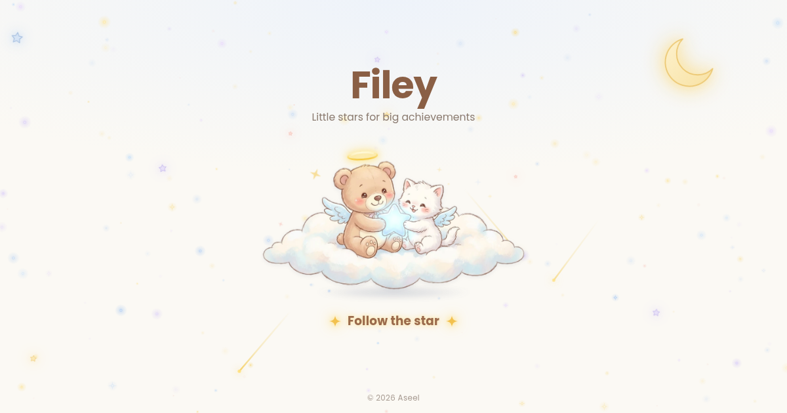

# Filey ✦

**Little stars for big achievements.**
A cozy, single-page website for sharing certificates through **one link**.
Visitors see a dreamy landing page with an angel teddy and kitten on a cloud, then a clean board of certificates they can search, open and download.

> **Status:** prototype. Simple, free to host on GitHub Pages, and usable by anyone.

**Live demo:** https://aseel-aihub.github.io/filey/



---

## Features

**For visitors**
- Animated landing page: twinkling and shooting stars, a glowing moon, and characters that blink and follow the mouse
- The owner's name, headline and LinkedIn / GitHub / website links
- Certificate cards with title, issuer, year, a verification link and a **View certificate** button for the attached image or PDF
- Search by title, issuer or year
- A direct link to every certificate (`.../filey/#cert-ID`)
- **Download all (ZIP)**: a summary page, a CSV file, the data file and the attached files. Works offline

**For the owner** (edit mode)
- Add, edit and delete certificates, with an optional image or PDF (images are compressed automatically)
- Edit your profile
- **Publish** with one click: your changes go live for everyone
- **Preview as visitor** before publishing
- **Export / Import backup** of all your data

---

## Files

| File | Purpose |
|---|---|
| `index.html` | The whole website (design, images and code in one file) |
| `certificates.json` | Your profile and certificates, which every visitor sees. Starts empty: `[]` |
| `preview.png` | The image shown when the link is shared on WhatsApp, LinkedIn, X and similar apps |
| `README.md` | This guide |
| `LICENSE` | MIT License |

---

## Get your own copy

1. **Fork** this repository, or download all the files and upload them to a new **public** repository.
2. Open the repository **Settings → Pages**.
3. Under **Source**, choose **Deploy from a branch**, then **main** and **/ (root)**, and save.
4. After a minute or two your site is live at `https://YOUR-USERNAME.github.io/REPOSITORY-NAME/`.
5. In `index.html`, change `og:url` and `og:image` in the **link preview** block to your own address, so the preview image shows when you share the link.

---

## Add and publish your certificates

1. Open your site with `?edit` at the end of the link:
   `https://YOUR-USERNAME.github.io/REPOSITORY-NAME/?edit`
2. Click **Edit profile** and add your name, headline and links.
3. Click **Add certificate** and fill in the details. Use the pencil icon on a card to edit it later.
4. Click **Publish**.
   - The **first time**, a window asks you to connect to GitHub (see the next section).
   - After that, Publish is **one click**.
5. Your site updates for everyone in about a minute.

Share the link **without** `?edit`. The **Copy page link** button does that for you.

> Until you click Publish, your changes are a draft saved only in that browser.

---

## Connect to GitHub (one time only)

Publish saves `certificates.json` straight to your repository. To do that, GitHub needs a **token**: a long password that lets the site write to your repository.

### Create the token

1. On GitHub, open **Settings → Developer settings → Personal access tokens → Fine-grained tokens** (or go to https://github.com/settings/personal-access-tokens/new).
2. Click **Generate new token** and fill in:

| Setting | Value |
|---|---|
| Token name | `Filey publish` |
| Expiration | A date you choose, for example 90 days |
| Repository access | **Only select repositories** → your Filey repository |
| Permissions → Repository permissions → **Contents** | **Read and write** |

3. Click **Generate token** and copy it (it starts with `github_pat_`). GitHub shows it only once.

### Add it to Filey

1. Open your site with `?edit` and click **Publish** (or the gear icon).
2. Check your **GitHub username** and **repository** (they are filled in automatically on GitHub Pages).
3. Paste the token and click **Save and publish**.

You enter the token **once per device**. To change it, or to remove it from the device, click the gear icon.

---

## ⚠️ Security warning

**This method is not fully safe.** The token is saved in your browser so you only enter it once, and that has risks:

- **Anyone who can use that browser can publish to your repository.** Use it only on your own device, never on a shared or public computer.
- **Enter the token only once, on your own device.** Don't paste it anywhere else, don't send it to anyone, and never put it in the code or in the repository.
- **Give it the smallest access:** one repository only, and only "Contents: Read and write".
- **Give it an expiry date**, and create a new one when it ends.
- **If you think it leaked, delete it on GitHub right away** (Settings → Developer settings → Fine-grained tokens → Delete). Then click "Forget the saved token" in Filey.
- Turn on **two-factor authentication** for your GitHub account.

If you prefer not to use a token at all, you can still publish by hand: click **Export backup**, then upload the downloaded `certificates.json` to your repository on GitHub (**Add file → Upload files**), replacing the old one.

---

## Backup

- **Export backup** downloads `certificates.json` with your profile and certificates.
- **Import backup** loads that file back, for example on a new device.

---

## Privacy

- **Everything you publish is public**, including attached files. Remove personal details such as ID numbers, phone numbers or addresses before uploading.
- **GitHub keeps file history.** A certificate you delete later still exists in older versions of the repository.
- `?edit` only shows the owner tools; it is not a password. Publishing needs your token.
- The page blocks outside scripts with a Content Security Policy, escapes all text before showing it, and only accepts `http` / `https` links.

---

## Test on your computer

Opening `index.html` directly works for the landing page and edit mode (Publish works too), but the browser blocks reading `certificates.json` from disk. To test exactly like GitHub Pages, run a small server in the project folder:

```bash
python3 -m http.server 8000
```

Then open `http://localhost:8000` (or `http://localhost:8000/?edit`).

---

## Limits of the prototype

- One owner per site. Each person makes their own copy for their own certificates.
- No database: everything is stored in `certificates.json` in the repository.
- Images are resized to 1600px and saved as JPG. PDFs must be 1 MB or smaller.

---

## Data format

`certificates.json` holds your profile and your certificates:

```json
{
  "profile": {
    "name": "Your name",
    "headline": "What you do",
    "links": { "linkedin": "https://...", "github": "https://...", "website": "" }
  },
  "certificates": [
    { "id": "c1", "title": "...", "issuer": "...", "year": 2026, "url": "https://..." }
  ]
}
```

A plain list of certificates (the older format) still works.

---

## License

Released under the [MIT License](LICENSE). You are free to use, copy and change it.
The illustrations are not covered by this license; see Credits.

---

## Credits

- Character illustration generated with Gemini AI 

Made by **Aseel**.
